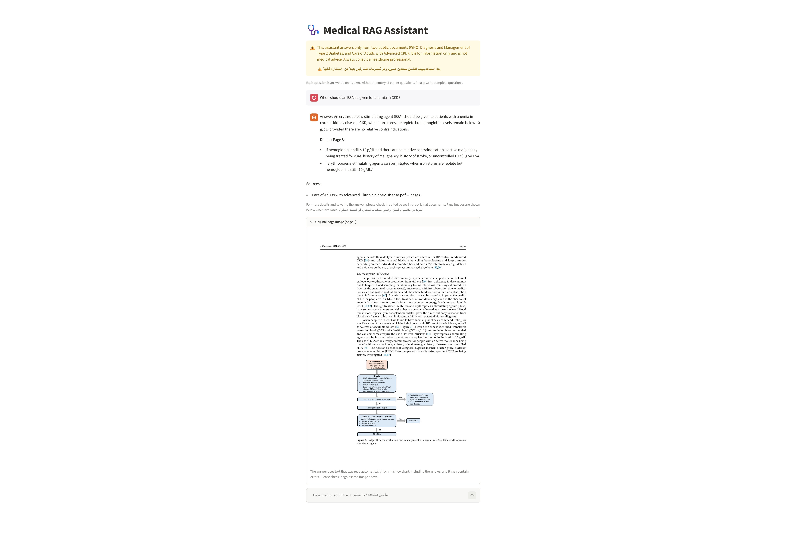
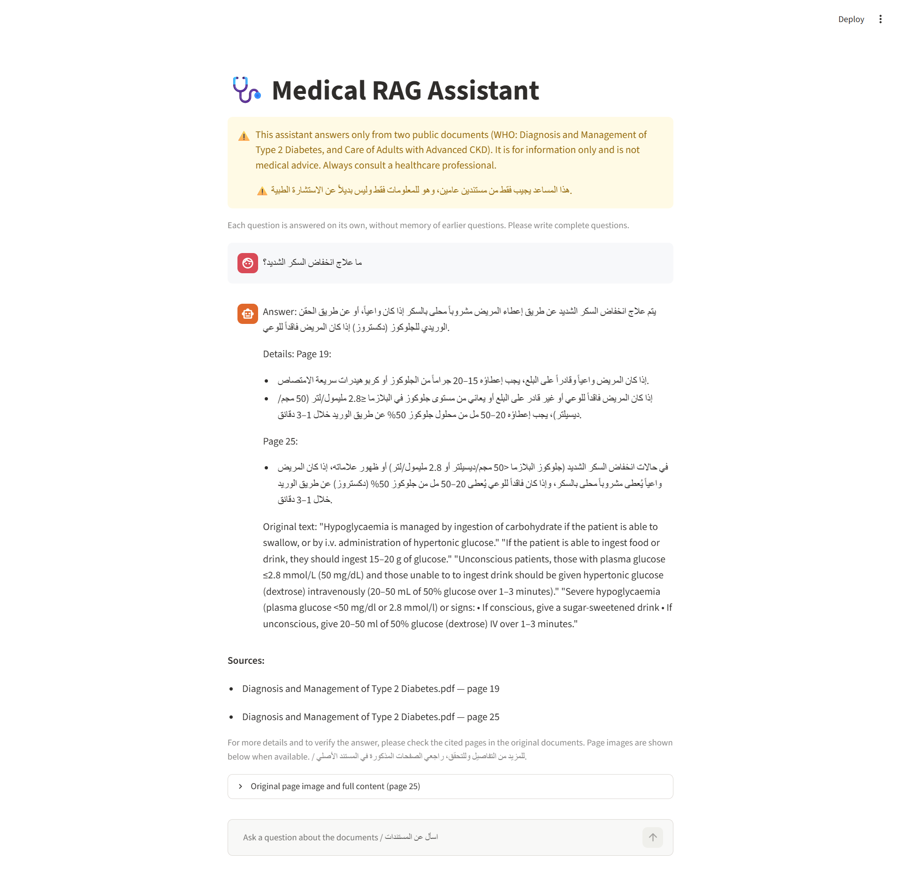
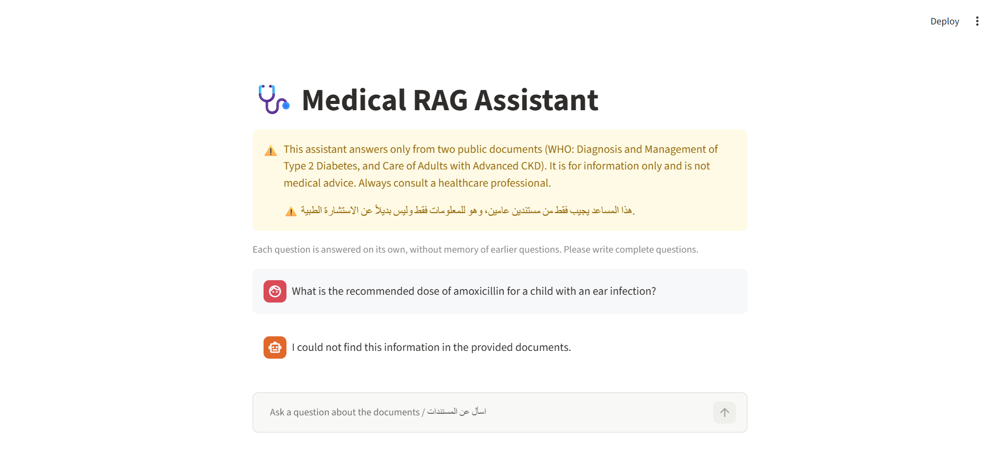

# Multimodal Medical RAG Assistant

## 📖 Overview

A small chatbot I built as a learning project. It answers medical questions (in English or Arabic) **only from two public PDFs**, shows the file and page of each answer, and shows the original page image for flowcharts and tables.

The two PDFs (download them from the official pages):

* [WHO, *Diagnosis and Management of Type 2 Diabetes* (HEARTS-D)](https://www.who.int/publications/i/item/WHO-UCN-NCD-20.1)
* [*Care of Adults with Advanced Chronic Kidney Disease* (J Clin Med, 2024)](https://pmc.ncbi.nlm.nih.gov/articles/PMC11313041)

If the answer is not in the documents, the app says: *"I could not find this information in the provided documents."*

> ⚠️ **Disclaimer:** this is a student project. It is not medical advice. Always check the cited pages in the original documents.

## 🛠️ Technologies

* Python
* PyMuPDF (text and table extraction)
* Gemini (describes flowcharts and tables, and writes the answers)
* BAAI/bge-m3 with FlagEmbedding (local multilingual embeddings)
* ChromaDB (vector database)
* Streamlit (web interface)

## 📌 Workflow

```
PDF pages
 ↓
Extract text and tables
 ↓
Describe flowcharts / complex tables with Gemini Vision
 ↓
Clean, merge, fix known errors
 ↓
Split into chunks (112)
 ↓
Embeddings (BGE-M3) → ChromaDB
 ↓
Question → closest chunks → Gemini answer with sources
 ↓
Streamlit app (answer, sources, page images)
```

## 📁 Generated Files

These files are created when you run the steps (they are not in the repository):

| File / folder | What it is |
|---|---|
| `data/extracted_content.json` | Text and tables of each page |
| `data/vision description/` | Gemini's description of each flowchart or complex table page (one text file per page) |
| `data/final_content.json` | Everything merged and cleaned |
| `data/diagram_images/` | Page images (PNG) that the app shows under the answer |
| `data/chunks.json` | The 112 small pieces of text used for search |
| `chroma_db/` | The vector database |

Each chunk looks like this (text shortened):

```json
{
  "chunk_id": "chunk_071",
  "source": "Diagnosis and Management of Type 2 Diabetes.pdf",
  "page": 16,
  "type": "diagram",
  "image_path": "data/diagram_images/Diagnosis and Management of Type 2 Diabetes_p16.png",
  "text": "..."
}
```

`type` is `text`, `table` or `diagram`. Tables and diagrams are never split.


## ⚙️ How to Install & Run

You need Python 3.10+ and a free Gemini API key from Google AI Studio.

1. Clone this repository and create a virtual environment:

```bash
python -m venv medical-rag-qa-env
# Windows: .\medical-rag-qa-env\Scripts\Activate.ps1
pip install -r requirements.txt
```

2. Copy `.env.example` to `.env` and write your own key and model name. **Never upload `.env`.**
3. Download the two PDFs and put them in `data/pdfs/` with these names:
   * `Diagnosis and Management of Type 2 Diabetes.pdf`
   * `Care of Adults with Advanced Chronic Kidney Disease.pdf`
4. Run the steps in order:

```bash
python src/extract_content.py
python src/describe_vision_pages.py
python src/merge_vision.py
python src/chunk_content.py
python src/build_index.py
streamlit run src/app.py
```

I did not upload the PDFs or the generated files (`data/`, `chroma_db/`) because I have not checked the licences yet. The steps above rebuild everything.

## 🧪 Tests

```bash
python tests/test_questions.py
```

It asks 10 questions (English and Arabic, two of them outside the documents) and checks that the expected words appear. A PASS only means the words appear, not that the whole answer is correct, so I also checked several answers by hand against the PDF pages.

## 🎯 Choices I Made

* Gemini describes the flowcharts and tables once. I checked the descriptions against the page images and saved them.
* I fixed a few errors by hand (5 flowchart arrows and 3 typos from the text extraction).
* I kept the typos that are already in the original PDFs (for example `SGTL2i`).
* Arabic questions are translated to English only for the search step.
* I first tried free OpenRouter models, but they were unstable or worse, so I used Gemini.

## 🚧 Known Limitations

* The model can misread arrows in flowcharts, so always check the page image shown under the answer.
* A general question can get a short answer. A more specific question gets a fuller one.
* The two diabetes flowcharts (page 16 and page 25) are not exactly the same, so the answer shows each page separately.
* Notes under tables are sometimes missing from the answer.
* The chatbot has no memory: every question is answered on its own.
* The free Gemini tier can be busy. The app tries again three times.

## 🔭 Next Steps

* Chat memory for follow-up questions.
* Show only the figure instead of the full page.

## 📷 Screenshots

English question with sources and page image:



Arabic question:



Question that is not in the documents:

